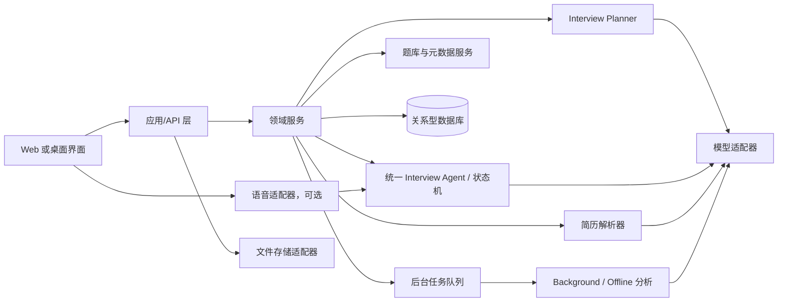
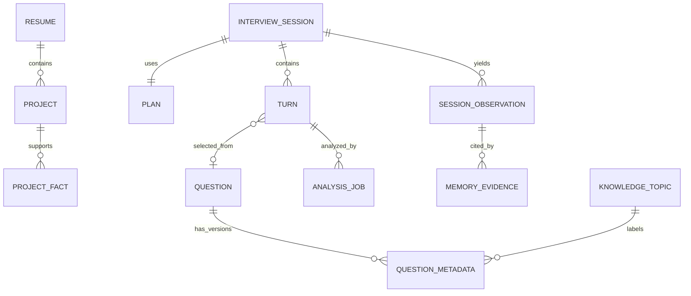

# 系统架构与数据实体

## 1. 架构约束

这是逻辑架构和基于简历的技术栈建议。V1 优先一个应用服务、一个持久化数据库、一个可选的后台任务执行器；不拆微服务，不引入多 Agent 框架。外部模型、未来语音和文件存储通过适配器封装。

## 2. 逻辑组件

| 组件 | 职责 | 明确不做 |
|---|---|---|
| Resume Service | 保存原始简历版本、抽取文本、离线解析项目与事实、提供人工校正。 | 不在每轮实时重读文件。 |
| Question Bank Service | 管理用户原文、元数据版本、导入和筛选。 | 不把 AI 草稿写回答案字段。 |
| Interview Planner | 将用户配置和可用证据转换为目标、比例/时间预算和策略约束。 | 不给出固定问题序列。 |
| Question Provider | 按当前目标生成项目问题，或从题库挑选通用题。 | 不单独维持自己的对话 Agent。 |
| Interview Runtime | 状态机、上下文窗口、Fast Path 决策、预算计量、事件持久化。 | 不等待深度分析。 |
| Analysis Service | 异步逐轮分析、面试后汇总、记忆候选生成。 | 不直接覆盖用户资料或标准答案。 |
| Model Adapter | 模型选择、超时、重试、schema 校验、用量记录与脱敏。 | 不泄露服务商差异到领域模型。 |
| Speech Adapter | 可选的录音、转写、播报或实时音频模型适配。 | 不决定考察目标或长期记忆。 |

## 3. 实体关系（逻辑 ER）

## 4. 实体/表建议

以下为逻辑字段，类型可依数据库适配。所有主键建议使用不透明 ID；时间戳存 UTC。JSON 用于有版本的 AI 输出与灵活配置，不替代需要查询的核心关系。

### `resume`

- `id`, `name`, `source_file_ref`, `source_text`, `content_hash`, `created_at`, `updated_at`, `is_active`
- 保存原件引用和抽取文本；新简历作为新版本，避免覆盖旧场次依据。

### `project`

- `id`, `resume_id`, `name`, `summary`, `role`, `duration`, `tech_stack_json`, `source_span_json`, `user_verified`, `created_at`, `updated_at`
- `source_span_json` 指向简历页/段落或文本片段，便于追溯。

### `project_fact`

- `id`, `project_id`, `fact_type`, `content`, `source_kind`（resume/user_edit）, `evidence_ref_json`, `confidence`, `verified_at`, `created_at`
- 事实类型示例：职责、架构决策、规模、指标、故障、权衡、结果。类型值保持可扩展。

### `question`

- `id`, `question_text`, `standard_answer_text`, `user_notes`, `source`, `is_active`, `created_at`, `updated_at`, `content_version`
- `question_text` 与 `standard_answer_text` 是用户所有的原文；AI 分类任务不得更新这些字段。

### `question_metadata`

- `id`, `question_id`, `category`, `sub_category`, `tags_json`, `difficulty`, `related_topics_json`, `origin`（ai/user）, `status`（draft/accepted/overridden）, `model_ref`, `created_at`
- 每次 AI 重标或人工修改新增版本；当前采用记录由 `question.current_metadata_id` 或查询规则确定。
- 标签建议保留置信度/来源；V1 的 related topics 是文本标签关联，不建立知识图谱。

### `interview_session`

- `id`, `status`, `started_at`, `ended_at`, `duration_target_sec`, `duration_actual_sec`, `config_json`, `resume_id`, `created_at`
- `status`: draft / planned / running / paused / completed / cancelled / failed。
- 单用户模式仍保存主体 ID 兼容未来迁移，但 V1 可由本地工作区固定，不实现账户/租户系统。

### `plan`

当前实现补充：`interview_plan.resume_id/source_version` 允许成对为空，表示纯题库计划；不创建空简历以绕过外键。简历项目模式仍固定真实简历版本。两种计划均冻结题库原文、答案、笔记和内容版本。项目快照新增可选简介与周期；旧记录缺失时为空，不从当前项目补值。迁移见 `0011_optional_plan_resume`。

- `id`, `session_id`, `plan_version`, `objectives_json`, `source_time_budget_json`, `constraints_json`, `approved_at`, `created_at`
- 不含固定问题列表；可含候选主题池，但候选主题不得绑定为严格顺序问题。

### `turn`

- `id`, `session_id`, `sequence_no`, `speaker`, `question_source`（project/question_bank/follow_up/system）, `question_id`, `objective_id`, `content_text`, `transcript_status`, `started_at`, `ended_at`, `audio_ref`, `decision_json`, `created_at`
- 追加式记录；更正转写时保存修订版本或转写审计记录，避免无痕覆盖。

### `analysis_job`

- `id`, `session_id`, `turn_id`, `kind`（background/offline）, `status`, `attempt_count`, `input_version`, `result_json`, `error_code`, `created_at`, `updated_at`, `completed_at`
- 幂等键建议为 `(kind, turn_id, input_version)`；面试后任务可按 session 和最终输入版本幂等。

### `session_observation`

- `id`, `session_id`, `turn_id`, `topic`, `observation_type`, `statement`, `confidence`, `evidence_quote`, `evidence_ref_json`, `created_at`
- 用于「本场观察」，不直接等价长期能力结论。

### `memory_evidence`

- `id`, `topic_key`, `observation_type`, `evidence_ref_json`, `confidence`, `direction`（supports/contradicts/unknown）, `observed_at`, `expires_at`, `created_at`
- V1 可以从 session observation 生成；聚合能力等级、遗忘曲线与画像 UI 延后。

### 可选辅助实体

- `model_run`: 模型、提示词版本、耗时、token 用量、schema 校验、脱敏后的失败码；不保存不必要的完整敏感输入副本。
- `resume_parse_job`: 简历解析状态、重试、解析版本。
- `question_import_job`: 导入批次和逐行错误，确保部分失败可恢复。

## 5. 数据不变量

1. AI 分类任务写入 `question_metadata`，不更新题干、答案或用户备注。
2. 面试场次引用当时的简历版本和 Planner 版本，保证事后可解释。
3. 所有评价性观察带回答证据引用；无证据则表达为未验证/不确定。
4. turn 按序号追加；重复请求通过幂等键避免重复轮次。
5. 删除简历/场次时按产品保留策略处理文件、转写、分析任务和记忆证据；关联数据不得无声孤儿化。
6. AI 输出未经结构校验不得驱动状态机转场。

## 6. 基于简历的技术栈建议

简历体现的实作经验包括 Python、FastAPI、Pydantic、SSE、MySQL、Redis、LangChain、LangGraph、Milvus/ChromaDB，以及 Qwen-plus 等模型调用经验；项目包含 RAG、Schema Linking、Agent 状态管理和 Plan-and-Execute。

| 层 | V1 建议 | 与简历经验的对应及取舍 |
|---|---|---|
| 应用服务 | Python + FastAPI + Pydantic | 直接沿用熟悉的异步 API、数据校验和服务开发经验。 |
| 主数据库 | SQLite（本地默认）；MySQL 保留 | 本地开发默认 `data/interview.sqlite3` 并在启动时自动迁移，单用户规模足够；MySQL 连接串仍受支持，用于需要时的迁移验证与将来部署。 |
| 前后端实时更新 | HTTP + SSE | 简历已有 SSE 流式接口经验；文本面试足以支撑逐字输出和状态事件。客户端提交答案仍用普通 HTTP。 |
| 实时决策 | 应用内 Python 状态机 + 一次结构化模型调用 | 有 LangGraph 经验，但 V1 的流程和状态数有限，先用可测试的普通代码降低运行与调试复杂度。 |
| 模型访问 | Qwen-plus 可作为首个候选，通过统一模型适配器接入 | 简历有此模型的项目使用经历；具体模型以延迟、结构化输出稳定性和成本实测为准。 |
| 后台任务 | 初版可用轻量后台任务；需要跨重启重试时再用 Redis 队列 | 用户熟悉 Redis；避免一开始增加必须维护的基础设施。 |
| 向量检索 | V1 暂不引入；后续有大量历史材料检索需求时再评估 Milvus/ChromaDB | V1 记忆按主题和证据结构化保存，Planner 只需少量摘要。 |
| 前端 | Vue 3 + TypeScript + Vite；开发服务器独立运行并代理 FastAPI API；生产构建产物由 FastAPI 同源托管 | 前后端分开开发，默认仍以单个 FastAPI 服务交付本地应用。选型与 UX 方案见 `docs/frontend/README.md`。 |
| 语音 | V1 不接入 | 后续单独测量端到端延迟，再选语音识别/合成或实时音频方案。 |

此表是技术方向。当前实现为 Python/FastAPI/Pydantic + 本地 SQLite（保留 MySQL）+ SSE；题库、资料、计划与文字面试已有独立 Vue 前端工程，开发时由 Vite 单独运行，生产构建由 FastAPI 同源托管。目录与运行入口见 [前端开发方案](frontend/README.md)。
