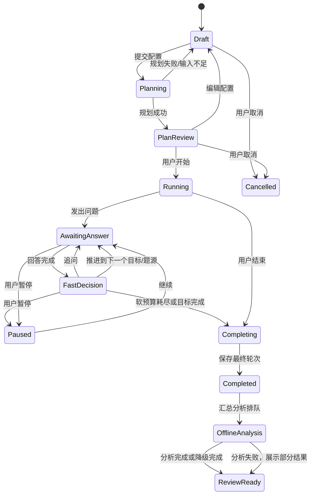
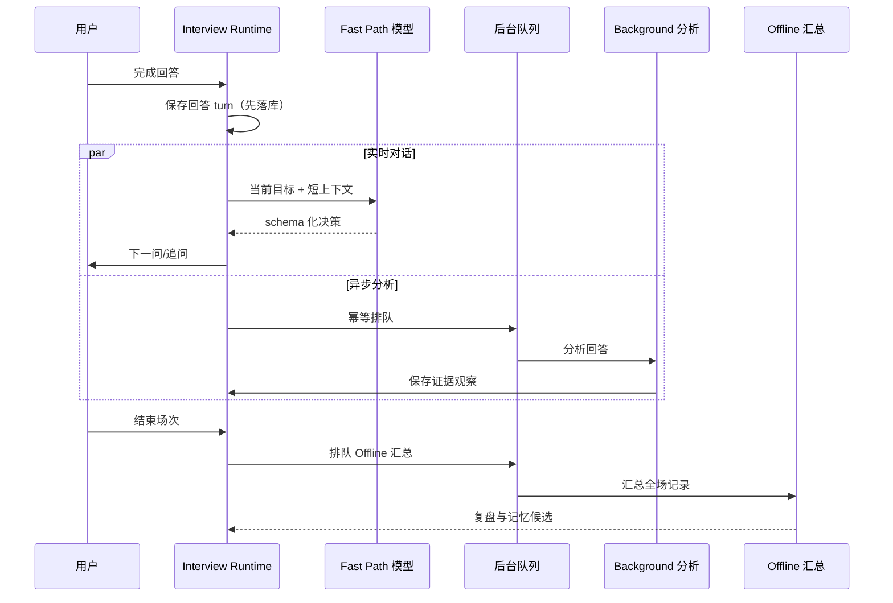

# 实时面试状态机与三级分析数据流

## 1. 首发方向

首发岗位聚焦大模型应用开发 / AI 全栈。可从简历和题库选取 RAG 检索链路、Agent 状态与工具调用、结构化输出、模型服务工程、数据/SQL 安全、后端交付等考察目标；目标必须由用户简历事实或题库材料支撑，不能仅凭岗位名称臆造项目经历。V1 只做文字问答，SSE 可用于流式显示问题生成或状态更新。

## 2. Planner 规划模型

Planner 输入：

- 场次配置：岗位/级别（可空）、时长、难度、项目题与通用题期望比例。
- 简历解析快照：已确认项目、技术、职责、结果和未核实事实。
- 题库快照：启用范围、元数据、用户选择的标签/难度。
- 可选历史摘要：带时间和置信度的弱项证据。

Planner 输出考察目标和约束，而非问题清单。每个目标至少包含 `objective_id`、主题、要验证的能力、优先级、可接受证据、建议来源、时间预算、最大追问数和切换条件。总时间预算应包含开场/收尾缓冲。

### 时间分配建议

- 将总时长分成开场缓冲、主题时间池和收尾缓冲。
- 按期望比例在项目题/通用题时间池之间分配；不要求每类题目的数量固定。
- 一轮回答和追问的实际耗时记入当前题源时间池；超过软预算时，完成当前语义闭环后转向下一优先级。
- 用户配置的比例是规划目标，不是硬性中断阈值。UI 显示计划与实际偏差。
- 若某题源无可用材料，重新归一化剩余来源并在计划中注明原因，不编造题目。

## 3. 状态机

### 决策循环伪逻辑

1. `select_objective`: 从未完成目标中选最高优先级，同时看剩余题源预算、剩余时长和最近覆盖情况。
2. `select_source`: 目标建议项目题时，从目标项目事实构造开放问题；目标建议通用题时，从启用题库筛选。必要时可切源。
3. `ask`: 保存问题 turn、来源、目标和所用 Planner 版本，再呈现/播报。
4. `capture_answer`: 得到文本或语音转写；标记完整/部分/低置信转写。用户沉默/未识别不等同于知识不足。
5. `fast_decide`: 仅使用当前目标、当前问答、最近少量上下文和简短记忆，决定追问/下一目标/跳过/收尾。
6. `enqueue_background`: 以幂等键提交逐轮分析，不等待任务完成。
7. `budget_guard`: 若时间不足，优先完成高优先级目标；避免中断正在进行的回答。达到结束条件时给出自然收尾。
8. 每次状态变更以事件/事务方式持久化，避免重新连接后丢失当前轮次。

## 4. Agent 的局部自主与 Planner 约束

### Planner 硬边界

- 考察目标集合、优先级、题源范围、禁用主题与最大追问数。
- 目标时长是软约束：只用于节奏参考，不因到时强制中断正在进行的一轮回答；实际偏差在界面展示。
- 用户显式选择的题库范围与难度。
- 不得捏造简历事实、题库答案或历史表现。
- 不得将 AI 自动生成答案当作标准答案。

### Agent 可调整范围

- 在同一目标下选择具体表述和追问角度。
- 根据回答质量减少或增加追问（但不超过上限）。
- 若出现有价值且相关的新线索，可进行有限局部追问，然后回到原目标或标记剩余目标。
- 在预算紧张、材料缺失或用户要求时跳过/切换题源。
- 不可悄悄改变 Planner 目标组合；重大偏移写入 `decision_reason` 和 session event。

### Fast Path 决策优先级

1. 尊重用户控制（暂停、跳过、结束）。
2. 判断当前回答是否可理解/转写可信；必要时先澄清，而非评价知识。
3. 检查当前目标是否已有足够证据。
4. 回答中出现关键缺口、矛盾或未解释主张时，最多进行有效追问。
5. 目标达成或追问价值低时，推进到下一个优先目标。
6. 所有高优先级目标完成，或软预算已明显超出且当前目标闭环时自然收尾；不因时间到强制中断回答。

## 5. 三级分析职责

| 路径 | 触发与时限 | 输入 | 输出 | 不负责 |
|---|---|---|---|---|
| Fast Path（实时） | 每轮回答结束即触发；受短超时预算约束，确切值待模型/语音选型 | 当前问题/回答、目标、近期对话、短期预算、少量记忆 | 切题度/目标覆盖、澄清或追问决定、下一问题、简短理由、信心 | 完整评分、跨场能力趋势、长期记忆更新 |
| Background Path（异步） | 每轮回答后并行排队 | 完整转写、问题/答案、标准答案参考（如有）、项目证据 | 知识点、正确性/遗漏观察、项目主张待核验项、带证据的本场观察 | 阻塞对话、修改答案原文、直接作长期能力定论 |
| Offline Path（面试后） | 场次完成后触发；允许更强模型和多阶段任务，但保持单一服务工作流 | 全部 turns、计划、各轮分析、历史结构化证据 | 逐题复盘、整体摘要、偏弱主题、矛盾/待核验线索、下次练习建议、记忆候选 | 无审核地重写题库答案或简历；无证据断言能力 |

## 6. 数据流与失败处理

- 回答先持久化，再调用 Fast Path；模型故障时可恢复已提交回答。
- Fast Path 超时/无效结构：不自动重试收费请求；不编造追问，按当前目标已覆盖情况推进，或给用户一个澄清/继续选择。
- Background 失败：保留任务状态并可重试；不能回滚或阻止实时对话。
- Offline 失败：展示逐轮已有结果与失败状态，支持重试；不能丢失整场记录。
- 转写置信度低：允许用户查看/修正文本；Fast Path 先澄清。
- 重复投递采用任务幂等键；同一版本输入不得重复追加记忆证据。

## 7. 渐进记忆

V1 保存「观察 + 证据 + 时间 + 置信度 + 来源场次」。同一主题多次出现后，Offline Path 可生成候选趋势，例如「最近三场都未解释锁释放的并发安全」。该趋势需能回溯原回答。

后续能力模型可按需增加主题掌握度/时间衰减/置信区间，但必须建立在多次证据上，并允许新证据修正旧判断。避免单一总分掩盖技能差异。
