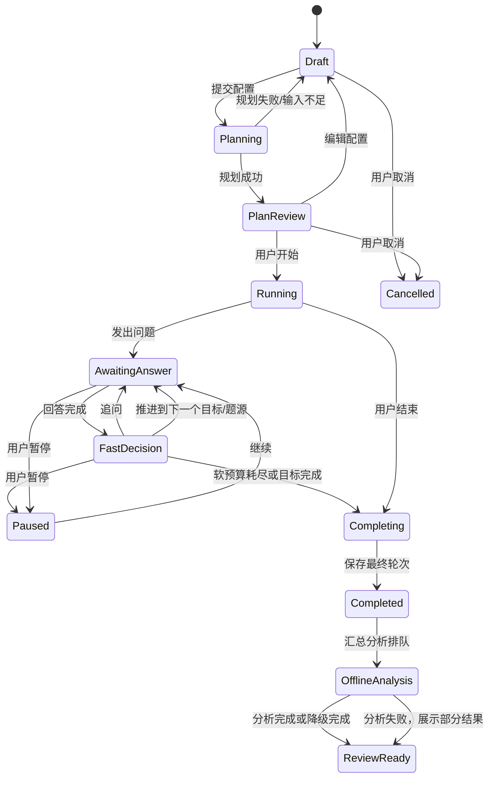
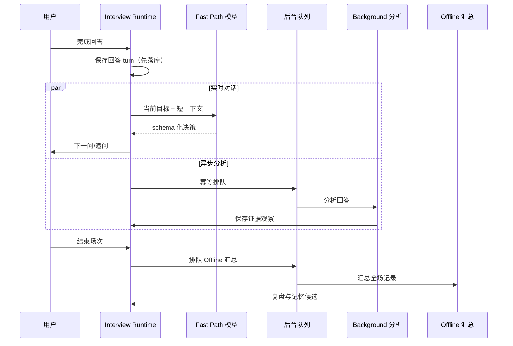

# 实时面试状态机与三级分析数据流

## 1. 首发方向

首发岗位聚焦大模型应用开发 / AI 全栈。可从简历和题库选取 RAG 检索链路、Agent 状态与工具调用、结构化输出、模型服务工程、数据/SQL 安全、后端交付等考察目标；目标必须由用户简历事实或题库材料支撑，不能仅凭岗位名称臆造项目经历。V1 只做文字问答，SSE 可用于流式显示问题生成或状态更新。

## 2. Planner 规划模型

Planner 输入：

- 场次配置：岗位/级别（可空）、时长、难度、项目题与通用题期望比例。
- 简历解析快照：已确认项目、技术、职责、结果和未核实事实。
- 题库快照：启用范围、元数据、用户选择的标签/难度。
- 可选历史摘要：带时间和置信度的弱项证据。

Planner 输出考察目标和约束，而非问题清单。每个目标至少包含 `objective_id`、主题、要验证的能力、优先级、可接受证据、建议来源、时间预算、最大追问数和切换条件。总时间预算应包含开场/收尾缓冲。

### 时间分配建议

- 将总时长分成开场缓冲、主题时间池和收尾缓冲。
- 按期望比例在项目题/通用题时间池之间分配；不要求每类题目的数量固定。
- 一轮回答和追问的实际耗时记入当前题源时间池；超过软预算时，完成当前语义闭环后转向下一优先级。
- 用户配置的比例是规划目标，不是硬性中断阈值。UI 显示计划与实际偏差。
- 若某题源无可用材料，重新归一化剩余来源并在计划中注明原因，不编造题目。

## 3. 状态机

### 决策循环伪逻辑

1. `select_objective`: 从未完成目标中选最高优先级，同时看剩余题源预算、剩余时长和最近覆盖情况。
2. `select_source`: 目标建议项目题时，从目标项目事实构造开放问题；目标建议通用题时，从启用题库筛选。必要时可切源。
3. `ask`: 保存问题 turn、来源、目标和所用 Planner 版本，再呈现/播报。
4. `capture_answer`: 得到文本或语音转写；标记完整/部分/低置信转写。用户沉默/未识别不等同于知识不足。
5. `fast_decide`: 仅使用当前目标、当前问答、最近少量上下文和简短记忆，决定追问/下一目标/跳过/收尾。
6. `enqueue_background`: 以幂等键提交逐轮分析，不等待任务完成。
7. `budget_guard`: 若时间不足，优先完成高优先级目标；避免中断正在进行的回答。目标时长只作节奏参考，当前实现不因超时自动收尾（结束条件为用户主动结束或所有目标完成）。
8. 每次状态变更以事件/事务方式持久化，避免重新连接后丢失当前轮次。

### 提问生成原则：基础问题预生成，追问即时生成

「提前生成问题」和「中途追问」不是二选一，两者解决的不是同一件事。本项目按下面的分界执行，后续实现和优化都以这条为准。

- **不提前排整场题单。** 面试开始前把题按顺序排好，追问就会退化成"照着脚本念下一题"，不再需要读回答，与「追问只针对你的回答」这一产品前提冲突。
- **基础问题属于骨架，可以预生成。** 每个考察目标的基础问题（项目目标 2 个、题库目标用用户原题）不依赖回答，只依赖该目标冻结的项目事实与题干，因此可以提前生成、可以跨场复用，也可以在无模型时用模板降级。骨架解决的问题是"切题要不要等模型"。
- **骨架已落地（`interview_outline.v1`），但按目标增量生成。** 创建场次时只为**第一个**待考察项目目标生成最多 2 个基础问题，其余目标在轮到它时再补一次同规模的小调用，全部存入 `interview_session.outline_json`（`source` 区分 `model` / `rule` / `fallback`）。这样「开始面试」的等待与单轮出题同量级，不需要先批量生成整场题单。题库目标不进骨架，仍用用户原题；骨架失败、未配置密钥或旧场次无骨架时逐级回退到规则模板与即时出题。
  - 预生成的目标必须和出题时选中的是**同一个**：场次的目标顺序按 ID 派生打乱，两处都要用这个顺序，否则开场白跑一次模型、再为同一个目标补一次。
  - 骨架要"必命中"：模型漏掉该目标时用规则模板补位，比回落到即时生成更快，也保证了开场只有一次调用。
  - 开场失败不等于开始失败：场次与首问是两个阶段，场次已落库时接口应返回快照并把错误写进 `error_code`，由「继续生成下一问」补，而不是 500。
- **追问必须即时生成。** 追问的输入是"这一轮回答里的具体缺口"，回答发生之前它不存在，所以不做预生成。追问解决的问题是"这一轮要不要继续挖"。
- **一次回答至多一次模型调用，且这次调用同时负责判定与措辞。** 模型先输出判定字段，再输出 `say`（面试官下一句），服务端流式解析后立刻转发；因此"判定"与"说出口"之间没有第二次往返。这也意味着骨架在正常路径上退居兜底：模型已经说出口的话必须原样落库，不能再用骨架替换。
- **追问是例外，不是默认。** 只有回答里存在可追问的内容（主张缺依据、数字无来源、关键取舍未说明、与给定事实矛盾）才追问；回答过短、只罗列关键词、明显不会或答非所问时不追问，改为换一个更基础的方面，或直接切到下一个目标。
- **等待必须可见，且先给首字。** 回答落库后立即回 `ack`，随后按增量推 `delta`；首字目标 1 秒内，整句 3–6 秒说完。不要用静态文案假装很快，也不要把整段生成藏在一个长请求里。
  - 流式效果的第一嫌疑是**网络路径**：本机代理软件会把 DashScope 延迟放大数倍（实测 5 倍），表现为"等几秒后整句蹦出"，而代码链路毫无问题。Qwen 客户端默认 `trust_env=false` 直连，这是刻意的；要改回去必须意识到代价。

实测（`qwen-plus`，本机，非流式）：单轮决策调用 5.6–7.4 秒，输入 1.4–1.8k tokens、输出 120–150 tokens。慢的根源是"每轮一次同步调用"，不是某次调用异常。缩短感知延迟有两条正交手段：**流式输出**（首字早到，用户开始阅读）与**输入裁剪**（预填长度直接计入首字延迟）；换成更快的模型可以同时降低两者，但会改变判定质量。调小超时没有用。

### 多场次多样性：考察目标固定，取题路径变化

同一份计划应该能练多遍，但每遍必须问到不同的东西。分界是：**考察什么由计划决定，不能随机；从哪条证据、按什么顺序问，由场次决定。**

- **目标集合与完成标准固定。** `interview_runtime.v1` 里的目标、`completion_rule`、`observable_evidence` 是计划的约束，不因场次而变化；否则不同场次的练习结果不可比。
- **顺序由场次 ID 派生。** 用 `sha256(session_id)` 作为种子对目标（同优先级内）、题库题目、项目事实排序：同场次内稳定（`cursor` 依赖它，刷新与重试不会跳题），不同场次不同，且不需要额外存字段，进程重启后仍可复现。
- **跨场优先没问过的。** 题库题按同计划其他场次的出现次数稳定排序，没问过的排前面；都问过之后按次数轮转，不会出现"永远问同一道"。
- **措辞不重复。** 模型侧把本场已问题目与同计划历史场次近期问题一并作为 `asked_questions` / `avoid_recent_questions` 传入，并在系统提示里要求换角度、不得换个说法重复；面试相关调用单独设 `qwen_interview_temperature`（默认 0.8），资料抽取仍用默认温度，保证同一份资料抽出同一结果。
- **不做整场随机抽样。** 不给"随机挑目标"这类自由度：那会让高优先级目标被漏掉，也无法解释一场为什么没考到某个点。

## 4. Agent 的局部自主与 Planner 约束

### Planner 硬边界

- 考察目标集合、优先级、题源范围、禁用主题与最大追问数。
- 目标时长是软约束：只用于节奏参考，不因到时强制中断正在进行的一轮回答，也不因超时自动结束场次；超出目标 60 秒后不再新增追问，但仍可切目标或续问。实际偏差在界面展示。
- 用户显式选择的题库范围与难度。
- 不得捏造简历事实、题库答案或历史表现。
- 不得将 AI 自动生成答案当作标准答案。

### Agent 可调整范围

- 在同一目标下选择具体表述和追问角度。
- 根据回答质量减少或增加追问（但不超过上限）。
- 若出现有价值且相关的新线索，可进行有限局部追问，然后回到原目标或标记剩余目标。
- 在预算紧张、材料缺失或用户要求时跳过/切换题源。
- 不可悄悄改变 Planner 目标组合；重大偏移写入 `decision_reason` 和 session event。

### Fast Path 决策优先级

1. 尊重用户控制（暂停、跳过、结束）。
2. 判断当前回答是否可理解/转写可信；必要时先澄清，而非评价知识。
3. 检查当前目标是否已有足够证据。
4. 回答中出现关键缺口、矛盾或未解释主张时，最多进行有效追问。
5. 目标达成或追问价值低时，推进到下一个优先目标。
6. 所有考察目标完成后自动结束，或由用户主动结束；目标时长只作节奏参考，超时不强制收尾，也不中断正在作答的一轮。

## 5. 三级分析职责

| 路径 | 触发与时限 | 输入 | 输出 | 不负责 |
|---|---|---|---|---|
| Fast Path（实时） | 每轮回答结束即触发；受短超时预算约束，确切值待模型/语音选型 | 当前问题/回答、目标、近期对话、短期预算、少量记忆 | 切题度/目标覆盖、澄清或追问决定、下一问题、简短理由、信心 | 完整评分、跨场能力趋势、长期记忆更新 |
| Background Path（异步） | 每轮回答后并行排队 | 完整转写、问题/答案、标准答案参考（如有）、项目证据 | 知识点、正确性/遗漏观察、项目主张待核验项、带证据的本场观察 | 阻塞对话、修改答案原文、直接作长期能力定论 |
| Offline Path（面试后） | 场次完成后触发；允许更强模型和多阶段任务，但保持单一服务工作流 | 全部 turns、计划、各轮分析、历史结构化证据 | 逐题复盘、整体摘要、偏弱主题、矛盾/待核验线索、下次练习建议、记忆候选 | 无审核地重写题库答案或简历；无证据断言能力 |

## 6. 数据流与失败处理

- 回答先持久化，再调用 Fast Path；模型故障时可恢复已提交回答。
- Fast Path 超时/无效结构：不自动重试收费请求；不编造追问，按当前目标已覆盖情况推进，或给用户一个澄清/继续选择。
- Background 失败：保留任务状态并可重试；不能回滚或阻止实时对话。
- Offline 失败：展示逐轮已有结果与失败状态，支持重试；不能丢失整场记录。
- 转写置信度低：允许用户查看/修正文本；Fast Path 先澄清。
- 重复投递采用任务幂等键；同一版本输入不得重复追加记忆证据。

### 当前实现：先确认保存，再逐字说出下一句

- 页面使用 `POST /interviews/{id}/answers/stream`。它先在**请求作用域的独立会话**里做「校验 + 落库 + 提交」，然后返回 `text/event-stream`：
  - `ack`：刚落库的完整快照（`current_turn` 为空、`pending_turn_id` 指向这条回答）；
  - `delta`：`{"text": "..."}`，面试官的话按模型增量逐段到达；
  - `state`：本步结束后的完整快照；或 `error`：本步失败的原因。
  落库发生在返回流之前，所以客户端即使立刻断开，回答也不会丢。
- 后台任务 `run_decision_stream` 用**独立数据库会话**执行决策，把增量写进进程内的 `LiveStream`（key = `session_id:turn_id`，120 秒后回收）。流端点只是从它读取并转发，因此断开不会取消生成，重进页面能拿到落库结果；但已流过的中间文字不重放。内存状态、后台任务与 SSE 帧逻辑现集中在 `interview/streaming.py` 的 `StreamBroker`：将来换成共享通道时，路由与业务服务无需改动。
- 模型侧一次调用同时产出判定与措辞：`objective_status` → `follow_up_needed` → `say` → 其余字段。服务端用增量 JSON 字符串解码器（处理 `\"`、`\\`、`\uXXXX`）把 `say` 逐字取出转发，整包 JSON 到齐后再做一次 Pydantic 校验。
- `say` 落库时用的就是屏幕上已经出现的那句话，因此不会出现"流出来的文字被替换"。骨架因此退居兜底：只在 `say` 为空、切到题库目标或模型失败时取用。
- `POST /interviews/{id}/answers` 是非流式版本（同样先落库，决策交给 BackgroundTasks），保留给不支持流式读取的调用方；`GET /interviews/{id}/events` 仍是轮询数据库的降级通道，用于刷新后汇合状态。
- 后台任务异常会被兜底写入 `error_code=decision_task_failed`，前端提示「重试下一步」；进程重启导致的丢失同样由该按钮恢复，因为回答本身已提交。
- 暂停或结束仍然丢弃迟到的决策（写回前复查场次状态与轮次序号），恢复后需要手动点「重试下一步」；这是刻意的，避免暂停后突然冒出下一题。

### 当前实现：整场复盘（Offline Path）

- 场次结束后由 `POST /interviews/{id}/report` 触发，同步一次模型调用（实测 qwen-plus 约 34 秒），产出 `interview_report.v1`：整体达成度（solid/mixed/weak）、摘要、逐目标评价（status + 亮点 + 缺口 + 证据轮次引用）、弱项主题、练习建议与待核验线索。
- 输入按本节表格的 Offline Path 组装：目标定义（完成规则、可观察证据、每目标 2 条事实）、全部问答（每轮问题 200 字、回答 600 字、决策时的 objective_status 与 observation）。**题库目标的标准答案只在复盘阶段作为对照参考发送**；实时提问路径仍不发送。
- 每场一份报告：`interview_report` 表按 `session_id` 唯一，`request_key` 唯一做幂等重放；已有成品或重放同一标识都直接返回，不重复调用。模型失败落库为 `failed` 行（保留错误码供页面提示与重试），不回滚、不影响问答记录——对应「Offline 失败：展示逐轮已有结果与失败状态，支持重试」。
- 规则模式或未配置密钥时降级为统计报告（覆盖数、每目标的问答轮次索引），明确提示语义评价需要模型模式，与骨架的降级链同构。
- 模型输出的评价只保留已知目标 ID（编造的 ID 被过滤），并按计划顺序排列；`turn_sequences` 引用回答轮次号，页面据此显示「证据轮次」，评价可回溯到具体回答。

## 7. 渐进记忆

V1 保存「观察 + 证据 + 时间 + 置信度 + 来源场次」。同一主题多次出现后，Offline Path 可生成候选趋势，例如「最近三场都未解释锁释放的并发安全」。该趋势需能回溯原回答。

后续能力模型可按需增加主题掌握度/时间衰减/置信区间，但必须建立在多次证据上，并允许新证据修正旧判断。避免单一总分掩盖技能差异。
