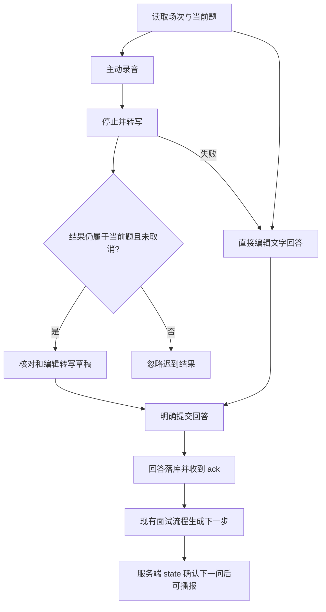

# 语音面试：交互与协议

状态：文字面试闭环已由用户验收。录音转写、手动朗读和停止朗读已接入，待用户启动验收；实时转写与自动断句仍属后续设计。

当前实现启用方式：在已有百炼配置中添加 `INTERVIEW_QWEN_ASR_MODEL=qwen3-asr-flash`。单段录音最长 180 秒，上传为 16 kHz 单声道 WAV。语音任务使用音频二进制请求体，`request_id`、`turn_id` 为查询参数，转写草稿有效期 30 分钟。服务端不保存音频文件；过期草稿会在读取对应任务或之后的转写任务执行时清理，保留幂等记录直至场次删除。浏览器只在本会话暂存任务标识，以便刷新后读取，不保存录音或草稿正文。

语音链路的实施进度和验收项见[设计审查待办](./05-开发计划与验收标准.md#6-设计审查待办)。

2026-11-23 已补暂停草稿保护和原录音重试，待用户验收。暂停会停止采集并保留本页录音、转写任务和候选，恢复后可继续处理。确认任务失败或过期时，可用仍在本页内存中的录音发起一次新转写，可能再次计费。上传结果未知时先查原任务，确认未接收时复用原请求标识。转写成功、明确丢弃或离开后释放录音。离开、跳题、结束及只提交回答框文字时，会提醒尚未使用的语音草稿。刷新只能找回有效期内已接受的转写任务。

## 首个可用版本

面试时主动开始和停止录音，停止后转写为可编辑的回答草稿，用户核对后再提交。问题始终显示文字，并提供「读出问题」「停止播报」。这一版优先保证每轮提交可靠，不要求说完即提交、边说边显示转写或开麦自动打断。

语音是交互方式，不是新的练习方式或面试模型模式。用户在现有练习入口选择文字或语音，在同一场次中可以切回打字。Planner、计划快照、目标、轮次、计时、追问额度和复盘继续共用：简历练习仍从自我介绍、项目介绍开始；纯题库仍只问所选原题。界面最终提交的仍是用户核对过的文本。

## 工作台与操作

| 状态 | 中央区域与主要操作 |
| --- | --- |
| 等待作答 | 显示本轮问题和「开始录音」，可点读题或直接打字；只在用户操作时请求麦克风权限。 |
| 录音中 | 显示录音标志、已录时长和「停止录音」「取消录音」；开始录音前停止读题，避免把朗读录进去。到达录音上限时停录并保留这一段，提示核对；录音上限与场次计时独立，不会自动提交或结束面试。 |
| 录音已结束 | 上传并转写；「转写中」与「回答已保存」分开。停用麦克风仍可查看问题或切回文字。用户明确取消等待后，晚到结果不能写进编辑器。 |
| 核对草稿 | 显示可编辑的转写；空文本或不确定片段提示用户重录或修正；用户点击「提交回答」才写入历史。编辑器已有内容时，转写先以候选出现，由用户决定是否使用。 |
| 提交与等待下一题 | 沿用文字的保存确认、生成提示和断线恢复。下一问以服务端当前问题为准，确定后可读出。 |
| 暂停或结束 | 停止录音和读题；有未提交内容时先提示。暂停可留本页草稿，继续后重新核对所属题目；结束不补交草稿，进入现有复盘。 |

权限拒绝、没有麦克风、录音不兼容、静音、转写失败、播放失败分别给出可恢复的提示，始终保留文字入口。提供键盘可达的录制、停止、取消和提交按钮；状态用文字与可读出的反馈表达，不只靠颜色或波形。跳题、切场次、关闭语音模式时立即停录并释放资源。读题被打断只改变播放器，不影响问题、追问或进度。

## 接口与恢复

**现有接口继续复用。** 场次和题目从 `GET /interviews/{session_id}` 读取；核对后的回答用现有 `POST /interviews/{session_id}/answers/stream`，请求体依旧是 `request_id`、问题的 `turn_id` 和 `answer_text`。收到 `ack` 或重新读取确认已落库后才标记已保存，`delta` 只作临时文字展示。断线先读原场次或订阅 `/events`，结果仍未知时沿用原请求标识和原请求体；提交结果未确认前，不把重新录音当成新的提交。暂停、恢复、跳题、结束沿用场次 revision 规则。

**只增加转写入口（建议路径）。** 首版按段上传，不需要双向音频流：

| 请求 | 约定 |
| --- | --- |
| `POST /interviews/{session_id}/transcriptions` | 上传单段音频和 `turn_id`、独立的 `request_id`。先校验当前场次可作答、题目未变化、格式与大小合规；建立可查询的任务后返回。相同请求标识对应相同场次、题目及音频内容，只读原任务；标识冲突拒绝。 |
| `GET /interviews/{session_id}/transcriptions/{request_id}` | 返回 `turn_id`、状态（等待 / 转写中 / 完成 / 失败 / 过期）、转写草稿及可选质量提示，或者稳定的错误码。它只读任务，不触发付费重试，也不创建面试轮次。 |

转写请求与提交回答使用不同的标识。发送前断线可在当前页面保留音频，恢复后用原标识重传；上传结果未知先读取任务，只有未接收时才用同一标识重传。重复上传和读取都不应重复调用转写。转写任务有超时；过期或失败后由用户明确选择重试或改用文字，不自动发起另一次收费。用户离开页面后，未上传的录音不保证恢复；已接受的任务在有效期内可用原标识查回。草稿修改仍遵循当前页面的未提交内容保护。

转写请求发出后如场次被暂停、切题或结束，晚到结果不得自动写入另一题。前端在应用结果前核对当前场次、当前题和本次录音标识；既有回答提交入口继续验证题目是否还能作答。录音取消或退出不等同于撤销第三方已开始的调用；若切回文字，迟到的结果也不能覆盖正在编辑的内容。

## 录音、播报与数据

- 首版音频仅用于转写，默认不保留为练习资产。录音临时保留到完成、失败或超时后清理，含进程重启后的过期清理；未提交的转写草稿也有过期时间。复盘、逐轮分析和 Planner 只读取正常保存的文本及既有结构化证据。音频、转写正文和密钥不进日志。
- 转写模型、允许的编码、单段时长、大小和保留时限在选型后定值。入口在调用模型前限制上传大小并验证实际编码和时长，录音端设置对应上限。若使用云端转写，录音前说明音频处理位置；只发送本轮音频，不附带简历、标准答案或其他轮次。供应商保留策略随选型核实。
- 朗读由用户手动触发，只使用当前正式问题正文，不朗读 SSE 片段或内部提示；开始录音、开始提交、暂停、切题或离开页面时停播。刷新或断线恢复不自动重播。优先使用浏览器提供的本地中文语音，没有时交给浏览器按中文选择，语音生成位置取决于设备与语音服务；项目后端不负责合成。中文音质和手机可用性需要真机验收，失败时始终保留文字。
- 文本模型保持现有 Qwen 配置。选语音供应商前用同一组中文、夹杂英文术语和数字的样本比较准确率、等待时长与费用；重点观察技术名词、数字和停顿。不要用模型的置信度代替用户核对，也不因没识别到声音而生成能力判断。

## 实施顺序与验收

1. **先实现录音 → 转写 → 核对提交。** 在现有工作台挂载语音交互区域，先用一场简历练习覆盖开场和技术问答，再用纯题库确认原题边界。拒绝麦克风、转写失败和静音都能回到文字，且没有提前写入回答。
2. **再加入读题、打断和恢复。** 验收读题时开始录音、转写中跳题、等待时切场次、暂停恢复、提交后断网等路径。应可继续正确的场次，迟到的转写不能覆盖其他草稿，重放不重复计费或提交。
3. **最后测延迟再决定是否流式化。** 记录停止录音到可编辑文本、提交到下一问题就绪、请求读题到开始播放三个阶段，分别观察中位数和 P95。同步观察转写失败和人工修正情况，再决定是否需要实时转写、自动断句、自动打断或 WebSocket/WebRTC。具体延迟门槛、首发浏览器和服务商在实测前不定为产品承诺。
