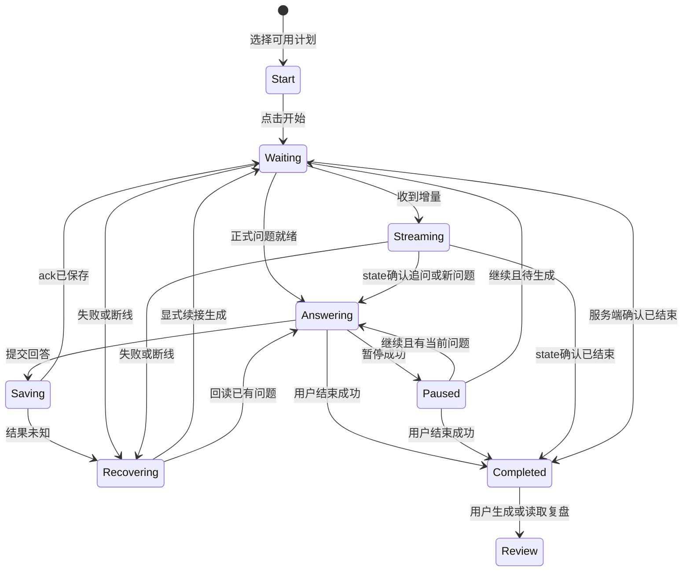

# 模拟面试 UX：自由切换式训练工作台

状态：待用户确认的设计。默认专注，自由展开辅助；不实现语音，不改取题、保存、预算或并发规则。

## 1. 开始与房间分离

面试入口分为“新建面试”和“面试记录”。有未结束场次时优先提供继续入口，保持现有恢复能力；不因进入页面自动创建新场次。记录显示方向、开始时间、状态；打开已结束场次进入回看和报告区。

新建面试选择可用已确认计划，或接收计划页带入的有效ID；显示方向、资料版本、目标数、预计时长和出题方式。主按钮“开始面试”明确可能调用模型。无可用计划时引导去规划，不允许空场次。旧计划不可用原因紧邻选项展示。

当前没有持久化自定义场次名称字段；**面试名称用方向/计划主题与日期组合展示**，有缺省名称“模拟面试”。不画出重命名表单或假设会保存用户命名。

## 2. 默认专注模式

```text
[导航/离开]  本场名称                         暂停 / 结束
已提问 N 次 · 目标已覆盖 K/M                  已用时 12:34

当前问题（完整可读，必要来源标记）
追问时：标记“追问”，可展开上一个问题与自己的回答

我的回答
可伸展编辑器
保存/生成状态                         [提交回答]

[我的参考答案] [当前目标] [相关知识点] [历史对话]
```

当前问题与回答承担主要视觉层级；名称、进度、用时紧凑，辅助入口是低强调工具条，不给每种信息一张大卡。题目没有固定总数，因此显示“已提问N次”或“第N问”，不显示虚假“第N/40题”、剩余题数或完成百分比。目标进度明确区分已覆盖、待考察、跳过，不把跳过计为掌握。

计时显示服务端场次的已用时间及预计时长，不设置归零自动交卷的倒计时。暂停是否排除计时取决于现有后端口径：本阶段不在客户端擅自停钟并产生不一致。五分钟宽限收尾冲突保留为待确认，见总体文档。

## 3. 自由切换的辅助面板

一次展开一种辅助内容，可切标签或关闭；打开不是离开面试，不清空编辑器，不自动暂停或保存回答。

| 面板 | 内容与边界 |
|---|---|
| 我的参考答案 | 当前目标关联的冻结版原题、自己的答案与笔记；明确是个人参考，未填写就如实提示；当前接口未保证逐题精确关联时显示“当前目标相关参考”，不冒称是当前题的唯一答案 |
| 当前目标 | 主题、观察证据、建议来源、完成条件、目标进度与追问边界；不泄露为“模型已判你通过” |
| 相关知识点 | 从已有目标主题、项目技术栈/事实和笔记提供阅读上下文；标明“已有资料线索”。没有数据时显示暂无，不请求模型自动讲解，不假设已有标签图谱 |
| 历史对话 | 按轮次显示已保存问题与回答，区分题库/项目/追问；局部定位对应轮次，不替换当前草稿 |

场次详情和记录选择在“更多/面试记录”中低频访问，仍能找到。参考读取失败只影响面板，显示重读入口；不能切换到今天的标准答案冒充场次依据。

大屏只有在主区仍≥约720px时才并列打开约360px面板；用户仍可自由输入。中屏以覆盖面板展示，显式关闭后回到回答；窄屏全屏辅助视图，顶部返回训练。并列面板为非模态；覆盖/全屏面板采用清楚的焦点边界、Esc返回。关闭恢复原选区，不能把光标一律移到末尾。

## 4. 完整状态与动作

| 状态 | 主区呈现 | 提交与控制 |
|---|---|---|
| 开始/生成首问 | 计划摘要、真实等待阶段 | 防重复开始；失败说明场次是否已保存，再引导读取记录/继续生成 |
| 可作答 | 当前完整问题、草稿编辑器 | 提交、暂停、跳过目标、结束；Ctrl/Cmd+Enter提交 |
| 提交中，尚无ack | 保留草稿，显示正在确认保存 | 锁定重复提交；不提前说已保存 |
| ack后等待 | “回答已保存，正在生成下一步”；可回看刚才回答 | 不要求再次输入同一答案；按现有busy策略禁用控制 |
| 流式反馈 | 临时面试官输出逐字显示，标记生成中 | 不把增量当最终问题；不在输入区插字；辅助阅读不自动滚回底部 |
| 追问就绪 | 终态确认后显示追问，关联上轮问答可展开 | 新回答编辑器恢复可用；焦点到输入，读屏提示新问题 |
| 切换问题/目标 | 紧凑显示来源/目标变化，新问题为主 | 不额外弹出“点击下一题”打断原有自动推进流程 |
| 暂停 | “已暂停”及当前问题概要，草稿保留 | “继续面试”为主、结束为次；不自动开始新场次 |
| 恢复 | 回读服务端状态；有问题回作答，无问题继续等待/恢复 | 不重复保存回答或重复发首问 |
| 已结束 | 结束原因、实际保存的问答与目标覆盖，转入回看 | 不保留可提交编辑器；提供生成/读取复盘 |
| 生成失败 | “回答已保存，下一步生成失败”或“首问失败” | 继续生成/读取状态，明确重试可能调用模型 |

AI实时输出用于维持对话和追问，不设计成每轮评分弹窗；详细评价仍放在结束后。流式文本成为最终正式问题前，不能显示“轮次已保存”或启用对该临时内容的作答。

## 5. 暂停、跳过与结束

暂停保留草稿，恢复回到同一问题上下文。现有生成期间控制不可用时，控制位置保留并显示原因；不承诺实时打断模型。若未来希望允许生成中结束，需先单独确认后端并发方案。

跳过对象是“当前目标”，确认说明本目标后续不再追问及未提交草稿将清空；取消则保持草稿。结束确认说明已保存回答保留、未提交草稿不保存，用户可取消返回提交；不增加尚无协议的“保存草稿并结束”。所有控制成功以后端状态更新为准，失败保留输入并回读状态。

## 6. 断线、错误与空态

| 场景 | 交互 |
|---|---|
| 无记录且无计划 | 新建入口解释先确认计划；不展示空聊天记录墙 |
| 有计划、无记录 | 选择计划开始；辅助面板默认关闭 |
| 参考答案/知识点为空 | 面板说明未填写/暂无关联资料，不自动补写 |
| 发送失败，不知是否保存 | 保留本地草稿，先读取本场记录核实；不得用新request_id立即自动重发 |
| ack后断流 | 说明回答已保存，回读/订阅状态；不承诺重放全部临时字符 |
| 服务端已生成但客户端未显示 | 用最终快照替换临时输出，保留一份正式轮次，避免双气泡 |
| 409 | 状态已变化，读取本场最新状态；草稿先保留供复制，不误投到另一个问题 |
| 模型失败 | 明确“继续生成”是显式新调用；不自动切规则模式或评价用户回答错误 |
| 场次读取失败 | 重试读取；不显示“已结束”或创建新场次掩盖错误 |

当前新建/回答请求ID在前端重试中的生命周期需实施前专项核对；本设计要求结果未知先核实，不表示现有前端已具备完整重试队列。草稿仅本页内存，刷新恢复的是保存记录，不是未提交文本。

## 7. 最终复盘与回看

结束先展示“本场记录已保存”，然后是“生成整场复盘”。已有报告只读取；生成中显示阶段，不伪装即时评分。失败仍可回看问题和回答，显式重试报告不重跑面试。

报告先整体摘要，再逐目标观察/不足、关联回答轮次、弱项和少量建议；整体文字标签保留为模型观察，不新增数值总分。点击轮次在回看视图定位对应问答并可返回报告位置。没有证据关联的结论不绘制虚假溯源入口。不能自动把建议写回题库、修改简历或加入长期记忆。

## 8. 滚动、响应式与未来语音

房间主内容约760–880px，页面为主要纵向滚动；编辑器高度随内容适度增长，不占满全部视野；超长输入才使用明确内部滚动。长问题始终完整可读，不能只露最后几行。控制条在低屏高和软键盘场景优先保留提交，次要说明换行，不层层吸顶。

小屏当前问题、回答、提交顺序连续；打开辅助使用单独全屏视图，返回原位置与选区。不依赖悬停揭露关键按钮。未来语音沿用同一场次、当前题、目标、控制及复盘语义，但有独立的录音/转写/播报/打断状态；本阶段没有麦克风按钮、音量动画、语音切换开关或假权限提示。

## 9. 状态流程



图中的服务端结束不为五分钟收尾政策背书；该政策仍待确认。图中暂停/结束边不意味着生成中控件可用。
