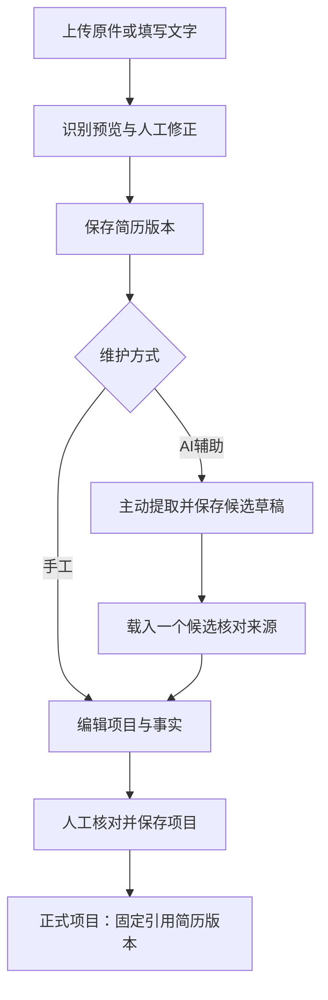

# 简历与项目 UX

状态：待确认方案；仅交互设计。目标：让用户始终知道正在看原件、机器候选还是自己确认的资料，并能高效核对依据。

## 1. 布局与信息层级

```text
全局导航
简历与项目                                     [新建简历]
简历导航约240px   当前简历 · 版本 · 使用状态
搜索/分页         [已保存资料] [项目与事实] [历史版本]
名称/当前版本      简历原文或项目详情           [查看来源]
                  编辑 / 提取项目等对象动作
核对时：          人工编辑区                   原件/指定版文字对照
```

默认先读已保存资料；上传和核对时才出现分栏。主体不长期挂一个空PDF框或空编辑器。简历列表显示名称、版本和启用状态，项目数量非必须，不能为了布局新增统计接口。

优先级：当前对象与版本 → 已保存内容/人工编辑 → 来源依据 → 候选与任务信息 → 技术用量。文件名、引擎版本、token 等低频信息收进详情；影响可信度的识别警告、来源缺失与未核对状态始终可见。

## 2. 三类对象必须分清

| 对象 | 标签与展示 | 可做什么 | 不能暗示什么 |
|---|---|---|---|
| 原始 PDF | “原件 · 不随编辑改变” | 查看、下载、选择识别方式 | 不能把编辑文字当作已修改PDF |
| OCR/AI结果 | “识别预览，尚未保存”或“AI候选，待核对” | 修正、查看证据、载入审核 | 引用可匹配和高置信度不等于事实已证实 |
| 用户保存/确认信息 | “简历 vN”/“项目已核对，依据 vN” | 阅读、编辑、查看版本或引用 | 简历保存不代表其中每项经历已独立核实 |

“结构化简历详情”按现有能力展示：简历名称、版本、启用状态、来源文件、完整文字及关联项目；项目含角色、时间、技术栈、说明和事实。暂不生成姓名、电话、教育经历等新字段表单，不从原文猜出未建模的结构信息。

## 3. 新建、上传与 PDF 预览

新建后提供上传 PDF 与手工文字两种入口，UTF-8文本文件入口保留为辅助。选文件前可选择自动/整份OCR/仅提取文字，解释其区别；默认自动。

处理区依次显示“上传/处理请求中 → 收到识别结果 → 核对并保存”，只使用可观测阶段，不假装能获取逐页进度。首次OCR下载模型可能慢，显示等待时间、保留当前草稿和错误恢复说明；不提供现有服务无法保证的“取消后台任务”。

**PDF预览为拟新增前端呈现**：本机所选文件或现有原件字节通过浏览器PDF能力只读预览，默认核对时打开。原件下载接口可提供字节，但预览可用性、加载回收和浏览器支持须实施时确认；本轮不指定PDF.js依赖或修改响应接口。浏览器不支持时明确“下载后查看”，文字核对仍可继续。没有页坐标契约，不承诺点击事实自动定位/高亮PDF。

桌面来源面板宽约40%，编辑约60%，随内容允许关闭预览；低宽度切换“文字/原件”单视图。原件内页码/缩放由可用预览能力提供，不能绘制不可工作的控件。

## 4. 文字、OCR与版本

- 识别预览顶部显示文件、模式、警告和“尚未保存”；人工修正文字为主操作，保存按钮“保存简历”或“保存为新版本”。
- 原件已保存但简历未保存时明确两者状态；离开提醒未保存文字，不宣称上传文件已删除。
- 重新识别前确认会替换当前编辑草稿；原件与历史不变。失败保留旧草稿，自动模式有可用文字时显示部分失败提示，整份OCR失败引导改模式或手工输入。
- “整理换行”说明仅整理排版；执行后显示“撤销整理”，继续人工编辑后不承诺多步历史撤销。
- 简历启停与文字版本分开显示。切换历史只读，不能自动把旧版装回当前简历。项目依据旧版时显示其版本，不静默绑定最新简历。

## 5. 项目与事实

“项目与事实”以已保存项目列表为默认内容；“手工新建项目”与“从简历提取”分别是人工维护与AI辅助。项目详情先展示名称、角色、时间、技术栈与说明，再展示事实；每条事实的引用在旁展开，无引用显示“手工补充”。

进入编辑后，在同一任务区域修改字段与事实。版本固定，来源文字可按需对照。勾选“我已核对”是明确动作，修改后状态按现有核对规则处理；页面不在关闭面板时自动保存。不提供项目编辑历史功能的假入口，历史版本入口明确属于简历。

## 6. AI候选审核

提取前摘要显示将发送“已保存简历 vN 的文字”，说明不上传原PDF；主按钮“提取候选项目”。运行后任务持久化，读结果不重新生成。

审核工作区左为候选及已确认状态，中为当前候选编辑，右为固定版来源文字/原件。屏宽不够时改为编辑与来源切换，不同时挤三栏。已有正式项目与AI候选列表分区，不把候选混进项目列表。

逐候选动作：载入核对 → 修正字段与事实 → 对照引用 → 勾选核对 → 确认并保存。成功标出“已保存为项目”，可打开正式项目；不自动跳下一个造成当前资料失去位置。未采用候选仅不确认，不新增服务端“拒绝/删除候选”状态。手工删改候选草稿不会删除原提取结果。



## 7. 状态、空态和错误

| 情况 | 呈现与下一步 |
|---|---|
| 无简历 | 紧凑说明上传或粘贴，主按钮新建；不保留空列表加空原件双占位 |
| 简历搜索无结果 | 保留搜索词，清除搜索；不要求重新上传 |
| 简历未保存 | 允许继续核对文字；项目提取不可用并说明需要先保存 |
| 已保存但无项目 | 项目区说明，手工新建为常规动作、提取为辅助动作 |
| 无PDF原件 | 显示“手工/文本资料”，来源为文字；不显示坏预览框 |
| 识别/提取中 | 等待与任务说明，保持草稿；刷新仅读结果 |
| 无有效候选 | 展示原因与警告，可手工新建；不自动重试模型 |
| 引用不匹配 | 对应事实显示错误，保留输入，引导从绑定版文字复制 |
| 409 | 保留简历/项目各自草稿，用户主动读取最新，不整页重置 |
| 模型/OCR/网络失败 | 分别说明，保留已有材料；恢复入口是改模式、读取任务或显式新调用 |
| 原件预览失败 | 下载原件与文字对照可继续；不误报简历保存失败 |

## 8. 响应式与滚动

宽屏资料导航约240px，主体页面滚动；来源对照为局部阅读区，只有打开时占空间。中屏简历导航收起；<900px单详情，来源/候选审核为可返回的全屏子视图，返回保留编辑草稿和候选位置。

长简历不困在固定高度卡片；事实列表随主文档滚动；原件允许独立滚动但不强迫与文字同步。工具条只保留当前对象保存/取消，不多层吸顶。保存简历不能清空另一标签中的项目草稿；切简历、切候选和返回列表前检查相关草稿。
