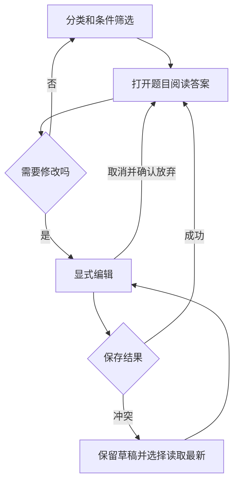

# 个人题库 UX

状态：待确认方案；仅交互设计。依据 [总体架构](UX_ARCHITECTURE.md) 与 [业务规则](BUSINESS_GUARDRAILS.md)。目标：快速找到一道题，舒适阅读自己的答案，需要时再修改和整理。

## 1. 布局、分区和优先级

```text
全局导航
题库                  [导入 Markdown] [新建题目]
分类（可收）   题目列表                 阅读区
全部/未分类    搜索题干、状态筛选        题干 + 分类/启用状态
自建分类       当前分类与结果数          [编辑] [历史] [来源] [更多]
新建/改名      本页勾选 → 批量操作       我的标准答案（主要内容）
               题目标题                 我的笔记
               分页                     版本/来源辅助信息
```

桌面采用约180px分类、300px列表、可伸展阅读区；答案正文上限约880px。列表只显示题干、必要分类/启用标记，不重复塞入答案摘要和AI标签。正文题干是上下文，答案是视觉中心；笔记随后；辅助元信息降为小型文本或展开项。不用多张等高卡片拆碎长答案。

分类可收起，收起后由列表头“分类：X”打开；点击分类更新列表，搜索与状态筛选在同一分类范围内工作，范围文字始终可见。保留已有筛选值，切换分类回到第一页；不默认把全部题目误当作当前分类。

## 2. 阅读与编辑

- 打开题目进入阅读态，显示完整答案，不自动进入表单。标题区紧凑，正文靠近内容起点，避免空白封面。
- 现有 Markdown 作为原文安全展示：保留空行、缩进、转义与复制内容，正文自然换行；代码相关长行可横向查看。此轮方案不要求富文本解析，也不执行HTML或识别图片。未来渲染与原文切换另作安全设计。
- “我的标准答案”为空时显示“尚未填写自己的答案”，提供编辑入口，不请求AI生成。笔记为空用轻提示，不保留巨大空白区域。
- 编辑在原阅读位置展开题干、答案、笔记、分类和启停表单；答案编辑器占主要空间。保存/取消明确；Ctrl/Cmd+Enter保存；只提交实际变化字段，未修改原文及换行保留。
- 保存成功回阅读态并保持当前题；列表刷新失败显示“内容已保存，列表未更新”，不能把保存成功误报失败。取消回原保存内容；切题/切分类/导航遇到草稿时确认放弃。
- 新增沿用同一编辑结构，分类默认当前真实分类，全部/未分类下默认未分类；答案和笔记允许空，题干必填。表单验证失败不清空输入。

## 3. 搜索、筛选与批量移动

搜索题干在列表头，Enter/搜索按钮执行；显示当前条件和“清除条件”。不承诺全文答案搜索、标签筛选或语义检索。启用状态筛选保留；AI元数据没有现成审核流程，不能成为主导航。

每行勾选与打开详情是不同点击目标。选择后列表顶部出现“已选 N 道 · 移动分类 · 取消选择”。仅支持本页选择，不隐含跨页全选；切页/更换筛选前提示将清除本页选择，取消则保持原列表。读取失败时不得用旧勾选移动不明确对象。

移动对话框包含数量、目标分类、未分类选项及原文不变说明。提交期间锁定本次选择；成功刷新计数并清除勾选，留在当前筛选，移出当前分类的题目自然消失。409 保留选择，先刷新并明确过期题目，再由用户重新选择；不自动按最新版重新提交。

## 4. Markdown 导入

使用大尺寸任务对话框，三个步骤“选文件 → 核对候选 → 导入结果”，不离开当前知识上下文。

候选审核左侧为原顺序候选及勾选，右侧为完整题干、答案、提示、来源段落/行号。推荐勾选、全选、全不选保留；提醒空答案/重复候选，不能只为减少操作全部默认确认。

确认前显示选中数量；按钮为“导入选中的 N 道”。确认结果未知时锁定同一选择，提供“重试确认”，不能回到选文件再点击产生重复。可关闭预览，已保存草稿仍在服务端；重新选择同文件/策略可读取原批次，不承诺尚无入口的草稿收件箱。

成功显示数量和是否安全重放，主动作“返回题库”，沿用现有导入后进入未分类列表的行为。图片只保留标记；编码/大小/拆分方式的错误在文件步骤解决，不自动切换规则或补写答案。

## 5. 历史与来源

阅读态“历史版本”打开右侧面板；选中版本标出版本号、时间、题干/答案/笔记，显示“历史只读”，可返回当前版本。没有一键恢复或差异比较的现有业务，不画出此类按钮。

“来源”展示原笔记段落、文件名、行号及下载原文件。手工题不显示失效来源按钮；来源读取失败可重读。进入编辑后先保存/取消再切换到历史，避免把历史误装入草稿。

## 6. 状态、空态与错误

| 情况 | 内容与可用动作 |
|---|---|
| 全库无题 | 紧凑说明“先放入自己的问答”，标题区保留新建/导入，不用空三栏占满屏幕 |
| 当前分类为空 | 分类导航保留；说明分类为空，提供新建到此分类或返回全部，不暗示数据库无题 |
| 搜索无结果 | 保留搜索词与筛选；“没有符合条件的题目 · 清除搜索/筛选” |
| 列表有题但未选择 | 显示“选择题目阅读答案”，不自动开启编辑，也不放大插画 |
| 内容加载 | 只在详情区域提示；保留列表可见，迟到响应不得覆盖新选择 |
| 保存中 | 锁定保存及会改变编辑对象的动作，保留原文可见 |
| 409 | 草稿保留，显示“复制草稿/读取最新”；读取前说明将替换编辑基线，由用户决定 |
| 404 | 当前题不可用；保留尚未保存草稿供复制，刷新列表 |
| 网络/数据库错误 | 区分读取失败与写入结果未知；局部重试，不自动新建 |

## 7. 响应式、滚动和焦点

≥1280px三栏；900–1279px分类为可收起导航，优先保障答案宽度；<900px单视图列表/详情，顶部“返回题目”恢复条件、分页和滚动。正文用页面滚动，桌面列表独立滚动；不把长答案锁在固定高文本框。

小屏编辑/导入/历史各占一个完整任务视图，返回路径一致；批量选择栏可换行，不遮挡题目；底部保存区为内容预留空间。打开题目焦点落到题干，返回列表焦点回对应题；对话框关闭回触发按钮。

## 8. 关键流程


