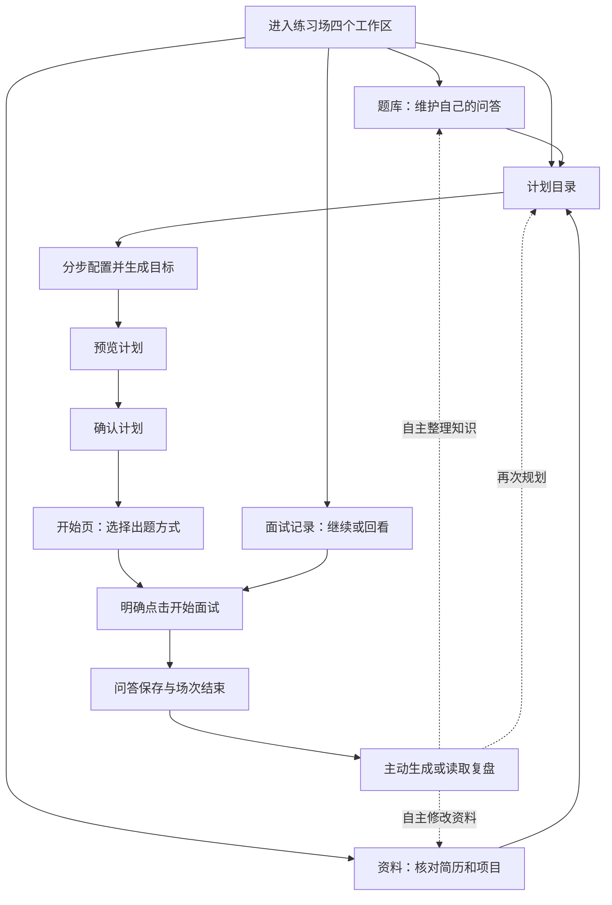
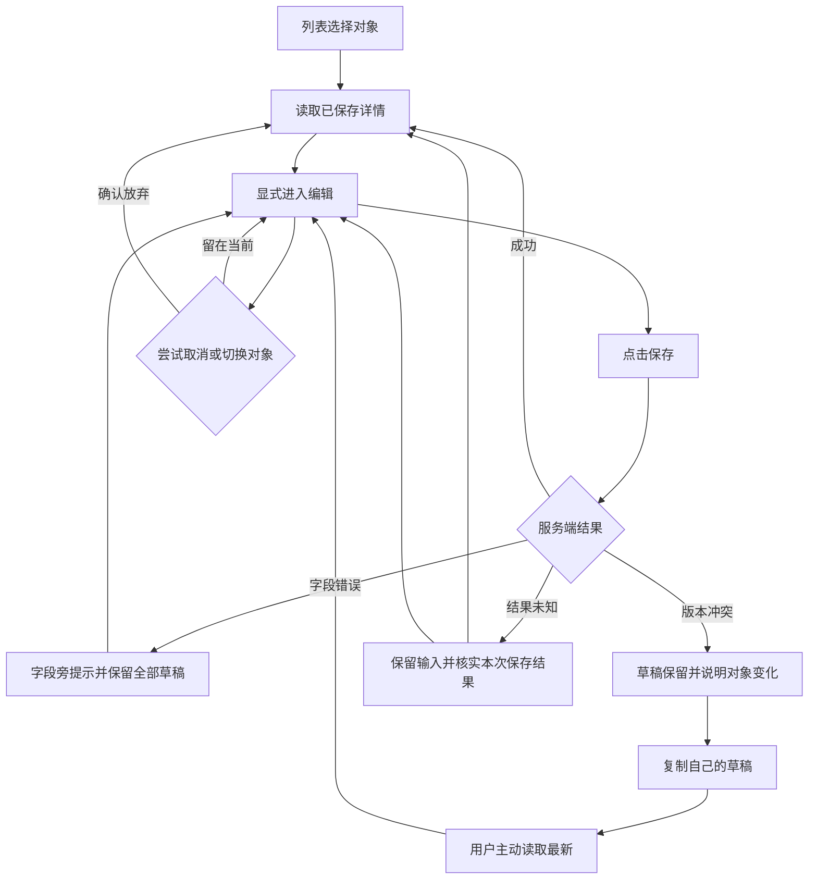
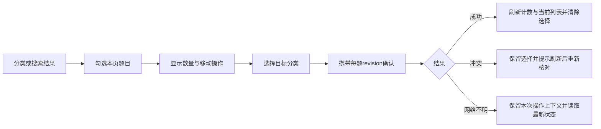
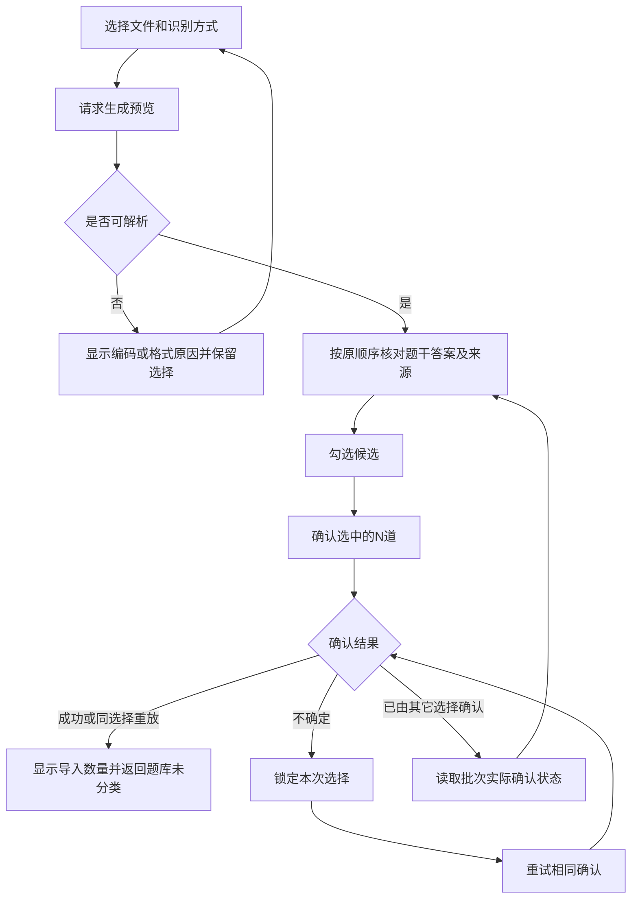
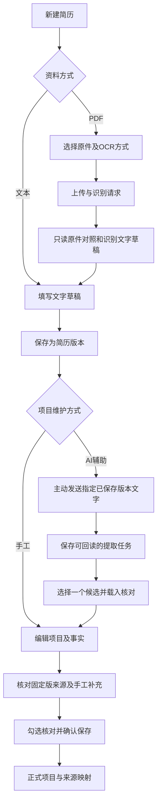
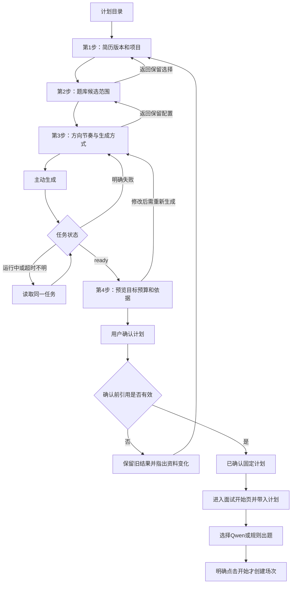
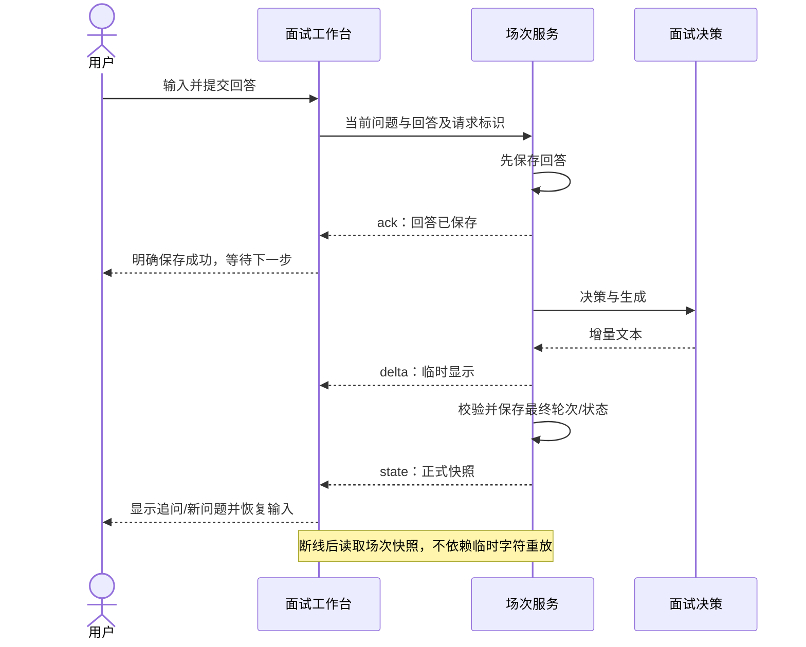
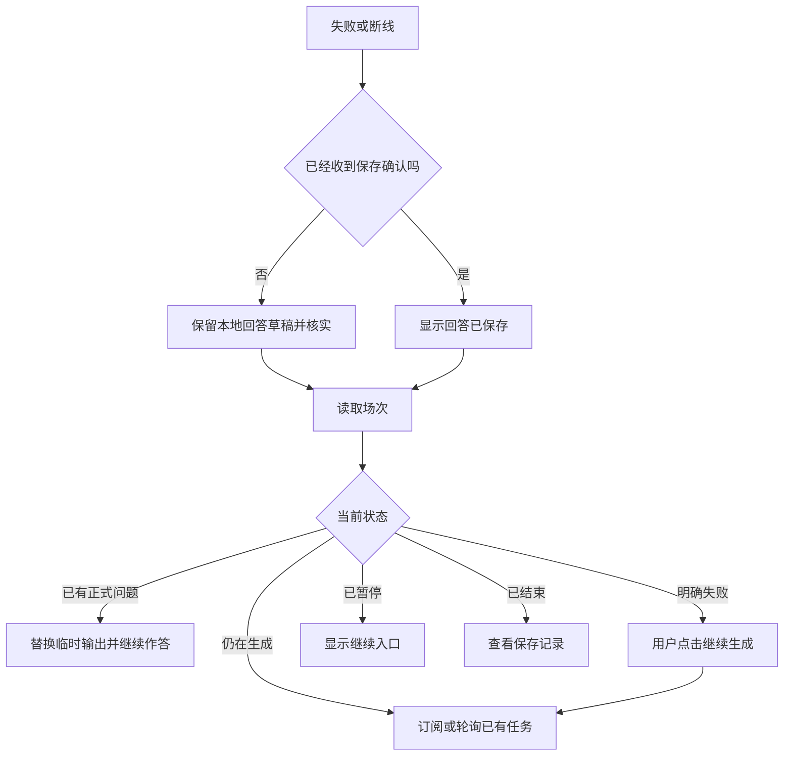
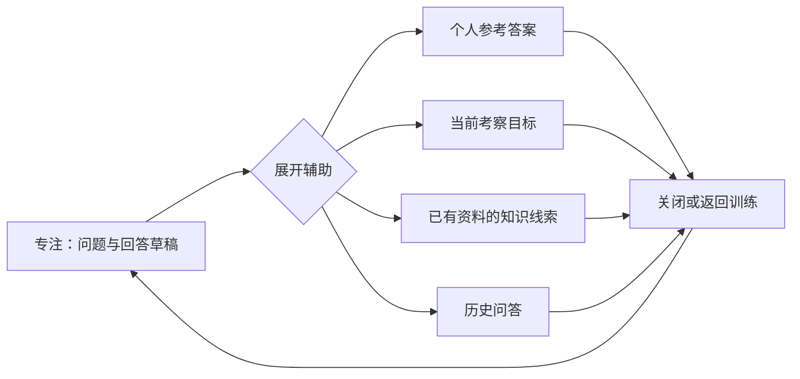
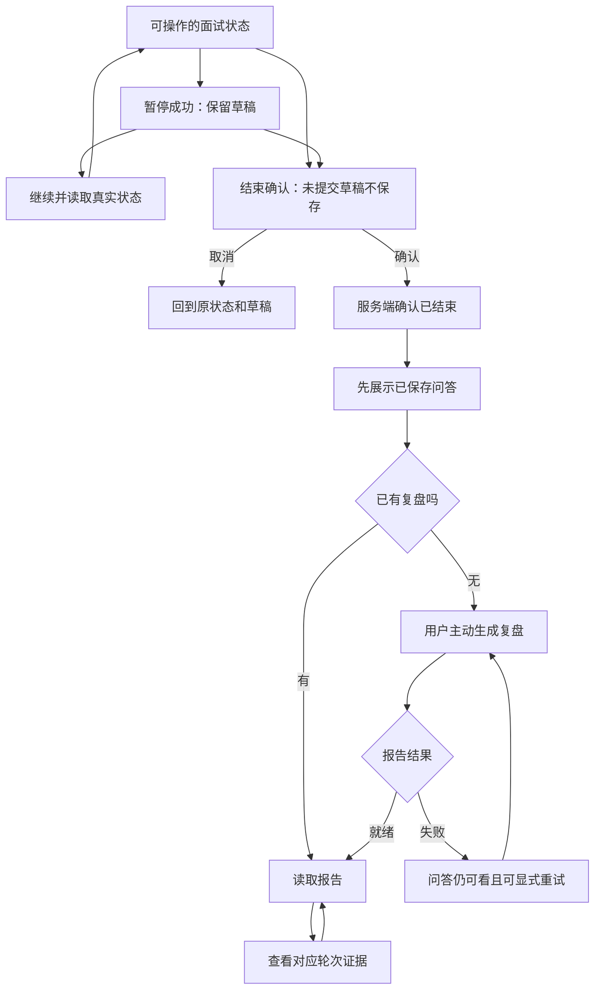

# 练习场关键用户流程

日期：2026-11-10。状态：待确认交互方案，不是已实现流程声明。下图省略底层实现细节，但保留读取、保存、生成和确认的区别。对应细节见 [总体架构](UX_ARCHITECTURE.md) 与四页 UX 文档。

## 1. 总体训练路径与返回路径

已有计划可直接进入开始页；已有场次可继续，不强制重新走准备流程。读取历史与生成复盘不同。最后三条路径不自动改内容，也不预填未实现的弱项记忆。

## 2. 阅读、编辑与并发冲突

适用题库、简历和项目；计划调整只生成新计划，不覆盖既有计划。

“核实”不代表自动覆盖草稿或盲目重发。尚无通用合并界面，不画成自动三方合并；删除与失效场景允许复制本地草稿后返回列表。

## 3. 批量移动分类

本页选择不自动扩大成跨页全选；换页或改变条件清除选择前给予说明。移动不增加答案内容版本，不改变用户原文。

## 4. Markdown 导入

预览只保存草稿；确认才创建题目。文件/策略变化形成另一批次，应明确提醒可能重复；不自动调用模型“修复”问题或补答案。

## 5. PDF、OCR和人工资料确认

OCR失败保留已有文字，可改模式或手工输入；AI失败保留原简历，不创建项目。PDF预览是拟新增呈现，不支持的浏览器使用下载兜底。重识别返回预览，只有保存才影响简历版本。

## 6. 分步 Planner 到面试开始

步骤1–3前进和后退不是服务端保存。确认与启动之间有独立决定，避免一次点击隐式调用两类模型。跨页带计划是前端导航建议，服务端仍检查可用性。

## 7. 面试提交、流式输出与恢复

恢复分支：

不在重连时自动提交第二份回答，不把模型失败写成用户答错。流和轮询只是读取机制，不代表完成持久化事件重放。

## 8. 专注模式与辅助自由切换

并列面板允许继续作答；覆盖面板返回时保留选区和滚动位置。切换辅助不暂停、不保存、不新增模型调用，不自动认定使用答案导致扣分。

## 9. 暂停、结束与复盘

生成中控制按钮仍受现有可用性限制。图中不指定超时自动收尾政策，也不表示暂停时计时已从后端扣除。

## 10. 跨页离开与未保存内容

| 来源 | 已保存内容 | 未保存内容 | 离开处理 |
|---|---|---|---|
| 题库编辑 | 原题及历史 | 当前改动 | 留在当前 / 放弃并离开 |
| 资料核对 | 原件、已存版本、提取任务 | 人工修正、项目编辑 | 指出是哪份草稿；一方保存不能清空另一方 |
| 计划步骤 | 已提交任务和历史结果 | 未提交配置 | 告知步骤不是自动保存；保留当前或放弃 |
| 面试 | 已ack回答、正式轮次 | 当前回答 | 留在当前 / 确认离开；不暗示退出页面自动结束场次 |
| 复盘 | 已保存问答和已存报告 | 无普通编辑草稿 | 读取失败局部重试；离开不重新生成报告 |

浏览器刷新或关闭无法依赖本地草稿永久保存。后续如增加自动草稿持久化，必须单独设计保留范围、生命周期和数据保护，本阶段不作承诺。

## 11. 确认范围

本次交付供用户确认的是六份文档中的交互方案：四种布局、阅读/编辑层级、来源核对、分步计划、确认与启动分离、专注面试及辅助面板。待确认的五分钟收尾、生成中控制、查看答案评价和暂停计时口径，仍作为独立问题，不在本阶段改变。确认设计后再按页面进入实施；本轮不编码、不改变接口或数据库，也不运行验证。
